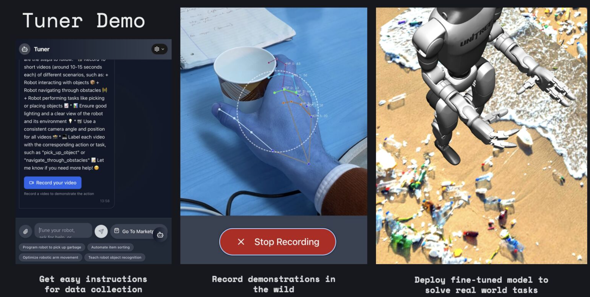

# Tuner - AI-Powered Robotics Task Platform

Tuner is a multimodal AI platform for robotics task optimization. It helps users find existing robot task models from a marketplace or record new demonstration data to train visual-to-policy models for robotics applications.

## Demo



## Features

- **Chat Interface** - Conversational AI assistant for robotics tasks with support for text, image, and video inputs
- **Video Recording** - Record robot demonstrations via webcam or custom video stream for training data collection
- **Marketplace** - Browse, search, and filter pre-built robot task models by category and robot type
- **Multimodal Processing** - AI-powered analysis of text, images, and video using Groq's multimodal models
- **Task Matching** - Vector similarity search to find existing marketplace tasks that match your needs
- **Hand Tracking** - Real-time hand tracking visualization from backend video feed

## Tech Stack

**Frontend:** React 19, Vite, Tailwind CSS, React Webcam, Lucide Icons

**Backend:** FastAPI, Neo4j (vector database), Groq API (multimodal LLM), Uvicorn

## Getting Started

### Prerequisites

- Node.js
- Python 3.x
- Neo4j database
- [Groq API key](https://console.groq.com)

### Environment Variables

Create a `.env` file in the `Backend/` directory:

```
DATABASE_URL=neo4j://localhost:8080
DATABASE_USER=neo4j
DATABASE_PASSWORD=<your_password>
GROQ_API_KEY=<your_groq_api_key>
```

### Frontend

```bash
npm install
npm run dev
```

### Backend

```bash
cd Backend
pip install -r requirements.txt
python main.py
```

## Project Structure

```
tuner/
├── src/                     # React frontend
│   ├── TunerChatv2.jsx      # Main chat interface
│   ├── components/
│   │   ├── Markeplace.jsx   # Task marketplace
│   │   ├── HandTracker.jsx  # Hand tracking video stream
│   │   ├── OptionModal.jsx
│   │   └── RecordingModal.jsx
│   └── assets/
│       └── marketplacedata.js
├── Backend/                 # FastAPI backend
│   ├── main.py              # Server entry point
│   ├── api/                 # Routes & Groq client
│   ├── Instructor/          # Request routing & task classification
│   ├── database/            # Neo4j client & schema
│   ├── multimodal/          # Text, image, video processors
│   └── config/              # Settings
├── index.html
├── vite.config.js
└── package.json
```

## How It Works

1. User describes a robotics task or uploads media through the chat interface
2. Backend processes multimodal inputs and generates embeddings via Groq API
3. Neo4j performs vector similarity search against existing marketplace tasks
4. If a match is found (confidence > 0.8), the marketplace task is suggested
5. Otherwise, the user is guided to record demonstration videos for training a new model
